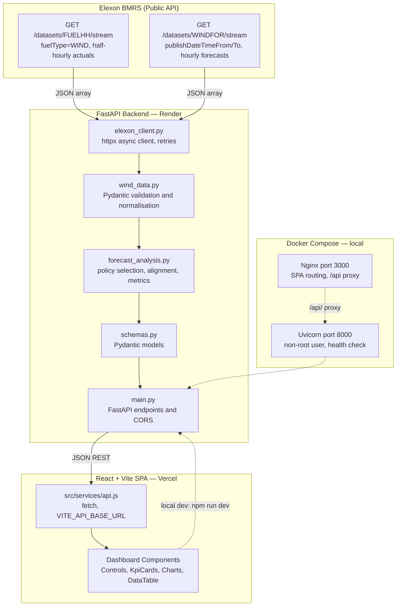
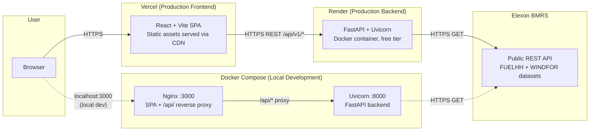

# UK Wind Intelligence

**UK national wind generation forecast evaluation and procurement analytics — January 2026.**

UK Wind Intelligence evaluates how closely day-ahead wind generation forecasts matched actual generation for the GB electricity market. It supports procurement teams in understanding forecast uncertainty before making day-ahead electricity purchasing decisions, using official data from the Elexon BMRS API.

---

## Quick Links

| Resource | URL |
|---|---|
| **Live Frontend** | [https://uk-wind-intelligence.vercel.app/](https://uk-wind-intelligence.vercel.app/) |
| **Backend API** | [https://uk-wind-intelligence-api-afun.onrender.com/](https://uk-wind-intelligence-api-afun.onrender.com/) |
| **Backend Health Check** | [https://uk-wind-intelligence-api-afun.onrender.com/health](https://uk-wind-intelligence-api-afun.onrender.com/health) |
| **Interactive API Docs (Swagger)** | [https://uk-wind-intelligence-api-afun.onrender.com/docs](https://uk-wind-intelligence-api-afun.onrender.com/docs) |
| **GitHub Repository** | [https://github.com/Hemanshu004/UK-Wind-Intelligence](https://github.com/Hemanshu004/UK-Wind-Intelligence) |

> [!NOTE]
> The backend is hosted on Render's free tier. If the service has been inactive, the first request may take up to 60 seconds while the container wakes up. Subsequent requests respond normally.

---

## Table of Contents

1. [Business Problem and Objectives](#1-business-problem-and-objectives)
2. [Project Scope](#2-project-scope)
3. [Elexon Data Sources](#3-elexon-data-sources)
4. [Analysis Methodology](#4-analysis-methodology)
5. [Dashboard Features](#5-dashboard-features)
6. [Architecture and Technology Stack](#6-architecture-and-technology-stack)
7. [Repository Structure](#7-repository-structure)
8. [Local Setup Instructions](#8-local-setup-instructions)
9. [API Reference](#9-api-reference)
10. [Configuration and Deployment](#10-configuration-and-deployment)
11. [Testing and Quality](#11-testing-and-quality)
12. [AI Tool Usage and Development Practices](#12-ai-tool-usage-and-development-practices)
13. [Limitations and Future Improvements](#13-limitations-and-future-improvements)
14. [Demonstration Video](#14-demonstration-video)
15. [Submission Checklist](#15-submission-checklist)

---

## 1. Business Problem and Objectives

A UK energy utility must make day-ahead electricity procurement decisions before actual renewable generation for the following day is known. Wind is a variable resource: if the forecast overstates generation, the utility will have over-purchased wind energy (a long position); if it understates generation, the utility will be short and must buy additional energy at potentially higher real-time prices.

This project addresses **two primary analytical objectives**:

1. **Forecast Retrieval with Publication Awareness** — For any delivery interval in January 2026, identify the wind generation forecast that would have been available to a decision-maker at a configurable gate-closure time (e.g. D-1 at 12:00 UTC). Forecasts are filtered by their `publishTime` to prevent look-ahead bias: only forecasts published at or before the assumed decision cutoff are eligible.

2. **Quantitative Forecast Evaluation** — Compute standard accuracy metrics (MAE, RMSE, signed bias, MAPE) and data coverage statistics over matched forecast/actual pairs for any delivery sub-range of January 2026. This helps procurement teams understand the magnitude and direction of forecast uncertainty.

---

## 2. Project Scope

| In Scope | Out of Scope |
|---|---|
| National GB wind generation outturn (FUELHH, fuelType=WIND) | Regional or plant-level generation |
| National wind generation forecasts (WINDFOR) | Electricity demand, prices, thermal generation |
| Historical delivery period: January 2026 | Other renewable sources (solar, hydro) |
| Data from Elexon BMRS only | Real-time or near-real-time feeds |
| Forecast evaluation against actuals | Calculating the utility's net procurement requirement |

> [!IMPORTANT]
> This is an analytical pilot for evaluating wind forecast accuracy. The application does **not** calculate the utility's actual additional procurement requirement, because consumer demand and all non-wind generation sources are outside scope.

---

## 3. Elexon Data Sources

### 3.1 Actual Generation — FUELHH

- **Endpoint (used by this application)**: `GET /datasets/FUELHH/stream`
- **Official documentation**: [https://bmrs.elexon.co.uk/api-documentation/endpoint/datasets/FUELHH/stream](https://bmrs.elexon.co.uk/api-documentation/endpoint/datasets/FUELHH/stream)
- **Authentication**: None required (public API, confirmed by live HTTP tests)
- **Query parameters used**:
  - `settlementDateFrom` — First settlement date inclusive (YYYY-MM-DD)
  - `settlementDateTo` — Last settlement date inclusive (YYYY-MM-DD)
  - `fuelType=WIND` — Filters to national GB wind generation only
- **Why `/stream`**: The standard `/datasets/FUELHH` endpoint imposes a 7-day maximum date window. The `/stream` variant returns a raw JSON array with no such restriction, allowing full-month queries.
- **Key fields used**:

  | Field | Type | Description |
  |---|---|---|
  | `startTime` | ISO-8601 UTC | Start of the 30-minute settlement period |
  | `settlementDate` | YYYY-MM-DD | Settlement date |
  | `settlementPeriod` | integer 1-48 | Half-hour period of the day (SP1 = 00:00-00:30 UTC) |
  | `fuelType` | string | Always `WIND` when filtered |
  | `generation` | integer (MW) | Average power output during the 30-minute period |
  | `publishTime` | ISO-8601 UTC | When this outturn record was published (optional) |

- **Resolution**: Half-hourly (48 settlement periods per day, 1,488 records for January 2026)

### 3.2 Forecast Generation — WINDFOR

- **Endpoint (used by this application)**: `GET /datasets/WINDFOR/stream`
- **Official documentation**: [https://bmrs.elexon.co.uk/api-documentation/endpoint/datasets/WINDFOR/stream](https://bmrs.elexon.co.uk/api-documentation/endpoint/datasets/WINDFOR/stream)
- **Query parameters used**:
  - `publishDateTimeFrom` — Earliest publication time inclusive (ISO-8601 UTC)
  - `publishDateTimeTo` — Latest publication time inclusive (ISO-8601 UTC)
- **Key fields used**:

  | Field | Type | Description |
  |---|---|---|
  | `startTime` | ISO-8601 UTC | Delivery interval start time (hourly resolution) |
  | `publishTime` | ISO-8601 UTC | When this forecast revision was published by the ESO |
  | `generation` | integer (MW) | Forecast average power output for the delivery interval |

- **Resolution**: Hourly delivery intervals (24 per day), multiple forecast revisions per interval
- **Revision history**: The backend queries publications starting 3 days before the requested start date (`start_date - 3 days`) to ensure all day-ahead and earlier revisions are captured. All historical revisions are returned so the frontend can apply a configurable purchasing cutoff.

---

## 4. Analysis Methodology

### 4.1 Forecast Selection Policies

The backend implements three configurable policies to select which forecast revision to use for each hourly delivery interval. The core rule is: **only forecasts with `publishTime <= cutoff` are eligible**; of those, the one with the latest `publishTime` is selected.

| Policy | API value | Cutoff computation | Use case |
|---|---|---|---|
| Day-Ahead Fixed Cutoff | `day_ahead` | `(D-1)` at a configurable HH:MM UTC (default `12:00`) | Simulates a day-ahead gate-closure decision |
| Rolling Lead Time | `rolling` | `startTime - lead_time_hours` | Evaluates accuracy at specific lead times (e.g. 24h, 12h, 4h, 1h) |
| Latest Before Delivery | `latest_before_delivery` | `startTime` (delivery start) | Operational benchmark: best possible forecast available before delivery |

> [!IMPORTANT]
> The D-1 cutoff at **12:00 UTC** is a **configurable project assumption**, not a verified official Elexon market rule or regulatory gate-closure time. It is configurable via the `day_ahead_cutoff_time` query parameter and adjustable in the dashboard controls.

**Tie-breaking**: If two forecast revisions share the exact same `publishTime`, the one with the higher `generation` value is selected (deterministic).

**Look-ahead bias prevention**: A forecast with `publishTime > cutoff` is never selected, regardless of how much more accurate it might be, because it would not have been available to the decision-maker at the assumed cutoff time.

### 4.2 Temporal Alignment (Half-Hourly Actuals to Hourly)

FUELHH actuals are published at 30-minute resolution; WINDFOR forecasts are at hourly resolution. The backend aligns two half-hourly actual readings to each hourly delivery interval:

- Settlement period `2k-1` covers interval start `T` (e.g. 14:00-14:30)
- Settlement period `2k` covers `T + 30 min` (e.g. 14:30-15:00)

Hourly actual generation is the **arithmetic mean** of the two readings:

```
Actual_hourly = (Actual_(2k-1) + Actual_(2k)) / 2.0  [MW]
```

**Completeness requirement**: Both half-hourly readings must be present. If either is missing, the hour is classified as `INCOMPLETE_ACTUAL` and excluded from accuracy metric calculations. MW values represent average power rate, not energy volume; they are never summed or doubled.

### 4.3 Interval Status Classification

Each hourly interval receives one of four statuses:

| Status | Meaning |
|---|---|
| `MATCHED` | Both forecast and complete actual are present; contributes to accuracy metrics |
| `MISSING_FORECAST` | No eligible forecast published before the cutoff |
| `INCOMPLETE_ACTUAL` | At least one of the two half-hourly actual readings is missing |
| `MISSING_BOTH` | Neither forecast nor complete actual is available |

### 4.4 Accuracy Metrics

All metrics are computed **exclusively over `MATCHED` intervals** (both forecast and complete actual available):

| Metric | Formula | Unit | Notes |
|---|---|---|---|
| **MAE** | mean(abs(Forecast - Actual)) over N matched intervals | MW | Average magnitude of error |
| **RMSE** | sqrt(mean((Forecast - Actual)^2)) over N matched intervals | MW | Penalises larger errors more heavily |
| **Bias** | mean(Forecast - Actual) over N matched intervals | MW | Positive = systematic over-forecasting |
| **MAPE** | mean(abs(Forecast - Actual) / abs(Actual)) * 100, zero actuals excluded | % | Zero actuals excluded from denominator; `null` if no non-zero actuals |
| **Coverage** | Matched Intervals / Expected Intervals | % | Data availability, not forecast accuracy |

**Sign convention**: Error = Forecast - Actual. A positive bias indicates the forecast consistently **over-stated** wind generation. A negative bias indicates the forecast **under-stated** generation.

**MAPE edge case**: When actual generation is zero or very small, MAPE is excluded for those intervals. If no non-zero actuals exist in the matched set, MAPE returns `null`. This is disclosed in the dashboard.

When no matched intervals exist, **all accuracy metrics return `null`** (never zero). A `data_notes` field in the API response explains the reason.

---

## 5. Dashboard Features

The React SPA at [https://uk-wind-intelligence.vercel.app/](https://uk-wind-intelligence.vercel.app/) provides:

### 5.1 Analysis Controls (`Controls.jsx`)

- **Date range selection** — Pick any sub-range within January 2026 using date inputs with built-in min/max constraints
- **Quick presets** — One-click buttons for Full Month (Jan 1-31), Week 1 (Jan 1-7), and Single Day (Jan 1)
- **Forecast selection policy** — Dropdown to choose between the three policies (Day-Ahead, Rolling, Latest Before Delivery)
- **Configurable cutoff** — When Day-Ahead is selected: text input for the HH:MM UTC gate-closure time, with preset buttons for 11:00, 12:00, and 14:00
- **Rolling lead time** — When Rolling is selected: numeric input for lead-time hours, with preset buttons for 1h, 4h, 12h, 24h
- **Client-side validation** — Prevents invalid date ranges, missing lead-time values, and malformed cutoff times before submitting

### 5.2 Policy Banner (`PolicyBanner.jsx`)

After each analysis, a banner describes the active cutoff rule including the human-readable description emitted by the backend (e.g. `Day-ahead D-1 at 12:00 UTC (configurable project assumption; not an official market rule)`).

### 5.3 KPI Cards (`KpiCards.jsx`)

Five summary cards displayed after a successful analysis:

| Card | Content |
|---|---|
| Mean Absolute Error (MAE) | Average error magnitude in MW across matched intervals |
| Root Mean Squared Error (RMSE) | Error deviation in MW, penalising outliers |
| Forecast Bias | Mean signed error in MW with a badge ("Over-forecast" / "Under-forecast" / "Neutral") |
| Mean Absolute Percentage Error | Relative error (%), with zero-actual exclusion noted |
| Data Coverage | Matched / Expected hours with a percentage |

Metrics display `N/A` when the backing value is `null` (e.g. MAPE when no non-zero actuals exist).

### 5.4 Forecast vs Actual Time-Series Chart (`TimeSeriesChart.jsx`)

- SVG-rendered line chart showing forecast and actual generation over time (both in MW)
- Handles data gaps — missing values break the line rather than connecting to zero
- Interactive hover tooltip showing exact values for each interval
- Responsive to the queried date range

### 5.5 Signed Forecast Error Profile (`ErrorChart.jsx`)

- SVG chart of the signed error (Forecast - Actual) for each hour in MW
- Y-axis is symmetrical around zero, making over-forecasting and under-forecasting visually clear
- Interactive hover tooltip showing the error value and interval time

### 5.6 Hourly Interval Records Table (`DataTable.jsx`)

- Tabular display of every hourly interval in the requested range, showing:
  - Delivery start time (UTC), settlement date, and settlement period numbers
  - Decision cutoff time applied for the interval
  - Selected forecast generation (MW) and its publication timestamp
  - Aligned actual generation (MW, arithmetic mean of two half-hourly values)
  - Individual half-hourly actual readings
  - Signed error and absolute error in MW
  - Interval status badge (MATCHED / MISSING_FORECAST / INCOMPLETE_ACTUAL / MISSING_BOTH)
- **Status filter** — Show all intervals, matched only, or problem intervals only
- **Column sorting** — Click any column header to sort ascending or descending
- **Pagination** — Configurable page size (24 / 48 / ALL rows)
- **CSV export** — Downloads all records (not just the current page) with labelled column headers

### 5.7 Data Quality and Alignment Audit (`DataQualitySummary.jsx`)

- Counters for Expected Intervals, Matched Intervals, Missing Forecasts, and Incomplete Actuals
- Coverage percentage badge
- Methodology note explaining that accuracy metrics are calculated only over matched pairs
- Any `data_notes` message from the API (e.g. partial coverage warnings) displayed in a highlighted box

---

## 6. Architecture and Technology Stack

### 6.1 Architecture Diagram



### 6.2 Deployment Architecture



> [!NOTE]
> In production, the frontend (Vercel) communicates with the backend (Render) via HTTPS. Docker Compose is used **only for local development** — it is not the production hosting platform. The dashed lines in the diagram represent the local development path.

### 6.3 Technology Stack

| Layer | Technology | Version / Notes |
|---|---|---|
| Frontend framework | React | 19.3.x |
| Frontend build tool | Vite | 8.x |
| Frontend charting | Custom SVG | Built-in; no external charting library |
| Frontend linter | oxlint | 1.x |
| Backend language | Python | 3.11 (Docker); 3.9+ (local) |
| Backend framework | FastAPI | 0.110+ |
| Backend server | Uvicorn | 0.28+ |
| Backend HTTP client | httpx | 0.27+ (async, with retries) |
| Backend validation | Pydantic | v2 (bundled with FastAPI) |
| Backend config | python-dotenv | 1.x |
| Backend testing | pytest | 8.x |
| Backend async testing | pytest-asyncio | 0.23+ |
| Frontend container | Nginx Alpine (multi-stage) | node:20-alpine build, nginx:alpine serve |
| Backend container | Python 3.11 slim | Non-root `appuser` |
| Orchestration | Docker Compose v2 | Bridge network `wind_network` |
| Frontend hosting | Vercel | Vite preset, `frontend/` root directory |
| Backend hosting | Render | Free tier, Docker-based deployment |

---

## 7. Repository Structure

```text
.
├── backend/                      # Python + FastAPI backend service
│   ├── .dockerignore             # Docker build exclusion rules
│   ├── .env.example              # Backend environment variable template
│   ├── Dockerfile                # python:3.11-slim, non-root appuser, uvicorn
│   ├── main.py                   # FastAPI app, CORS config, and all API endpoints
│   ├── requirements.txt          # Python dependencies (pinned ranges)
│   ├── schemas.py                # Pydantic models for API I/O and internal data
│   ├── services/
│   │   ├── __init__.py
│   │   ├── elexon_client.py      # Async httpx client for FUELHH and WINDFOR streams
│   │   ├── forecast_analysis.py  # Policy selection, temporal alignment, metrics
│   │   └── wind_data.py          # Validation, parsing, and normalisation helpers
│   └── tests/
│       ├── __init__.py
│       ├── test_backend.py       # Health, normalisation, endpoints, error handling
│       └── test_forecast_analysis.py  # 15 test dimensions: policies, alignment, metrics
├── docs/
│   ├── architecture.md           # Detailed architecture, policies, metrics
│   └── elexon-api-investigation.md  # Empirical Elexon API verification report
├── frontend/                     # React 19 + Vite SPA
│   ├── .dockerignore
│   ├── Dockerfile                # Multi-stage: node:20-alpine build, nginx:alpine serve
│   ├── nginx.conf                # SPA routing, /api/ and /health reverse proxy, gzip
│   ├── package.json              # Scripts: dev, build, lint (oxlint), preview
│   ├── vite.config.js            # @vitejs/plugin-react
│   ├── index.html                # HTML shell
│   └── src/
│       ├── main.jsx              # React mounting point
│       ├── App.jsx               # Root component: state, data fetching, layout
│       ├── index.css             # Global design tokens and utility classes
│       ├── App.css               # App-level styles
│       ├── services/
│       │   └── api.js            # fetchAnalysis() and fetchHealth() using fetch API
│       └── components/
│           ├── Header.jsx        # Title bar with date range and data source badges
│           ├── Controls.jsx      # Date range, policy, cutoff, and submit form
│           ├── PolicyBanner.jsx  # Active policy and cutoff rule description
│           ├── KpiCards.jsx      # MAE, RMSE, Bias, MAPE, Coverage metric cards
│           ├── TimeSeriesChart.jsx  # SVG forecast vs actual line chart with tooltip
│           ├── ErrorChart.jsx    # SVG signed forecast error chart with tooltip
│           ├── DataTable.jsx     # Paginated, sortable, filterable table and CSV export
│           └── DataQualitySummary.jsx  # Coverage audit and methodology note
├── .dockerignore                 # Root Docker exclusions
├── .env.example                  # Root environment template (backend and frontend vars)
├── .gitignore                    # Excludes venv, node_modules, .env, build outputs
├── docker-compose.yml            # Frontend (port 3000) and Backend (port 8000) services
└── README.md                     # This file
```

---

## 8. Local Setup Instructions

### 8.1 Prerequisites

| Tool | Minimum version | Notes |
|---|---|---|
| Python | 3.9+ | Verified on 3.11 in Docker |
| Node.js | 18+ | Verified on 20 (LTS) |
| npm | 9+ | Bundled with Node 18+ |
| Docker Engine | 20.10+ | For containerised setup only |
| Docker Compose | v2.0+ | Use `docker compose` (not legacy `docker-compose`) |

### 8.2 Clone the Repository

```bash
git clone https://github.com/Hemanshu004/UK-Wind-Intelligence.git
cd UK-Wind-Intelligence
```

### 8.3 Backend Setup (Local Virtual Environment)

**Step 1 — Create the virtual environment:**
```bash
python3 -m venv backend/venv
```

**Step 2 — Activate it:**
```bash
# macOS / Linux
source backend/venv/bin/activate

# Windows (Command Prompt)
backend\venv\Scripts\activate.bat

# Windows (PowerShell)
backend\venv\Scripts\Activate.ps1
```

**Step 3 — Install dependencies:**
```bash
pip install --upgrade pip
pip install -r backend/requirements.txt
```

**Step 4 — Configure environment variables:**
```bash
cp backend/.env.example backend/.env
```

The defaults in `backend/.env.example` work for local development. No API key is required for the Elexon BMRS API.

**Step 5 — Start the FastAPI development server:**
```bash
cd backend && uvicorn main:app --reload --port 8000
```

**Verify the backend is running:**
- Swagger UI: [http://localhost:8000/docs](http://localhost:8000/docs)
- Health check: [http://localhost:8000/health](http://localhost:8000/health)

### 8.4 Frontend Setup (Local Development Server)

Open a **second terminal** while the backend is running:

```bash
cd frontend
npm install
```

The frontend reads `VITE_API_BASE_URL` at build time and defaults to `http://localhost:8000` if not set. To set it explicitly, create a local environment file:

```bash
echo "VITE_API_BASE_URL=http://localhost:8000" > frontend/.env.local
```

**Start the Vite dev server:**
```bash
npm run dev
```

The dashboard is available at [http://localhost:5173](http://localhost:5173).

### 8.5 Run Backend Tests

```bash
# With venv activated, from the backend/ directory:
cd backend
python -m pytest tests/ -v
```

Or from the repository root without activating the venv:
```bash
backend/venv/bin/python -m pytest backend/tests/ -v
```

### 8.6 Docker Compose (Containerised Full Stack)

This runs the frontend (Nginx on port 3000) and backend (Uvicorn on port 8000) in a Docker bridge network. The Nginx container proxies all `/api/` and `/health` requests to the backend container.

**Build and start all services:**
```bash
docker compose up --build -d
```

**Access local services:**

| Service | URL |
|---|---|
| Web Application Dashboard | [http://localhost:3000](http://localhost:3000) |
| Backend Direct | [http://localhost:8000](http://localhost:8000) |
| Swagger UI | [http://localhost:8000/docs](http://localhost:8000/docs) |
| Backend Health (direct) | [http://localhost:8000/health](http://localhost:8000/health) |
| Backend Health (proxied via Nginx) | [http://localhost:3000/health](http://localhost:3000/health) |
| Nginx Liveness Probe | [http://localhost:3000/nginx-health](http://localhost:3000/nginx-health) |

**View logs:**
```bash
docker compose logs -f           # all services
docker compose logs -f backend   # backend only
docker compose logs -f frontend  # frontend only
```

**Stop and clean up:**
```bash
docker compose down        # stop containers and remove network
docker compose down -v     # also remove volumes
```

**Force clean rebuild:**
```bash
docker compose build --no-cache
docker compose up -d
```

**Troubleshooting:**
- If port 3000 is in use, change `"3000:80"` in `docker-compose.yml` to another host port (e.g. `"3001:80"`).
- If port 8000 is in use, change `"8000:8000"` to `"8080:8000"` and update `CORS_ORIGINS` accordingly.
- Do not set `VITE_API_BASE_URL` to `http://backend:8000` in Docker Compose build args; the Nginx reverse proxy handles backend routing transparently.

---

## 9. API Reference

All API timestamps are ISO-8601 UTC. All generation values are in Megawatts (MW). The interactive Swagger UI is at [https://uk-wind-intelligence-api-afun.onrender.com/docs](https://uk-wind-intelligence-api-afun.onrender.com/docs).

### GET /

Returns basic service information.

```json
{"message": "UK Wind Forecast Analytics API", "docs_url": "/docs", "health_check_url": "/health"}
```

### GET /health

```bash
curl https://uk-wind-intelligence-api-afun.onrender.com/health
```
```json
{"status": "ok", "service": "UK Wind Forecast Analytics API", "version": "0.1.0"}
```

### GET /api/v1/wind/actuals

Returns half-hourly actual wind generation from FUELHH (fuelType=WIND).

| Parameter | Type | Required | Description |
|---|---|---|---|
| `start_date` | YYYY-MM-DD | Yes | First settlement date, inclusive |
| `end_date` | YYYY-MM-DD | Yes | Last settlement date, inclusive |

```bash
curl "https://uk-wind-intelligence-api-afun.onrender.com/api/v1/wind/actuals?start_date=2026-01-01&end_date=2026-01-01"
```

### GET /api/v1/wind/forecasts

Returns all WINDFOR forecast revisions for the requested delivery window. The backend queries publications from `start_date - 3 days` to capture all day-ahead and earlier revisions.

| Parameter | Type | Required | Description |
|---|---|---|---|
| `start_date` | YYYY-MM-DD | Yes | First delivery date, inclusive |
| `end_date` | YYYY-MM-DD | Yes | Last delivery date, inclusive |

```bash
curl "https://uk-wind-intelligence-api-afun.onrender.com/api/v1/wind/forecasts?start_date=2026-01-01&end_date=2026-01-01"
```

### GET /api/v1/wind/analysis

Evaluates forecast accuracy against actuals. This is the primary endpoint used by the dashboard.

| Parameter | Type | Required | Default | Description |
|---|---|---|---|---|
| `start_date` | YYYY-MM-DD | Yes | — | First delivery date, inclusive |
| `end_date` | YYYY-MM-DD | Yes | — | Last delivery date, inclusive |
| `policy` | string | No | `day_ahead` | `day_ahead`, `rolling`, or `latest_before_delivery` |
| `lead_time_hours` | float | Yes when policy=rolling | — | Positive hours before delivery (e.g. 24.0) |
| `day_ahead_cutoff_time` | HH:MM | No | `12:00` | UTC cutoff for day_ahead policy |

**Example — Day-ahead analysis for January 2026:**
```bash
curl "https://uk-wind-intelligence-api-afun.onrender.com/api/v1/wind/analysis?start_date=2026-01-01&end_date=2026-01-31&policy=day_ahead&day_ahead_cutoff_time=12:00"
```

**Example — Rolling 4-hour lead time:**
```bash
curl "https://uk-wind-intelligence-api-afun.onrender.com/api/v1/wind/analysis?start_date=2026-01-01&end_date=2026-01-01&policy=rolling&lead_time_hours=4"
```

**Abbreviated response schema:**
```json
{
  "start_date": "2026-01-01",
  "end_date": "2026-01-01",
  "policy": "day_ahead",
  "cutoff_rule": "Day-ahead D-1 at 12:00 UTC (configurable project assumption; not an official market rule)",
  "lead_time_hours": null,
  "expected_interval_count": 24,
  "matched_interval_count": 24,
  "missing_forecast_count": 0,
  "missing_actual_count": 0,
  "coverage_ratio": 1.0,
  "coverage_percentage": 100.0,
  "metrics": {
    "mae": null,
    "rmse": null,
    "bias": null,
    "mape": null,
    "unit": "MW",
    "bias_interpretation": "Positive bias indicates over-forecasting (forecast > actual); negative indicates under-forecasting."
  },
  "records": [
    {
      "delivery_start_time": "2026-01-01T00:00:00Z",
      "settlement_date": "2026-01-01",
      "settlement_period_start": 1,
      "settlement_period_end": 2,
      "cutoff_time": "2025-12-31T12:00:00Z",
      "forecast_generation": 19563.0,
      "forecast_publish_time": "2025-12-31T11:30:00Z",
      "actual_generation": 13814.5,
      "half_hourly_actuals": [13756.0, 13873.0],
      "error": 5748.5,
      "absolute_error": 5748.5,
      "status": "MATCHED"
    }
  ],
  "data_notes": null
}
```

> [!NOTE]
> The `actual_generation` of 13814.5 in the sample record (the arithmetic mean of 13756 and 13873 from Elexon FUELHH) and the forecast values are real data from the live API. Aggregate metrics such as MAE and RMSE depend on the full date range queried and are not shown as fixed values here to avoid presenting stale numbers as permanent facts.

**HTTP error codes:**
- `400` — Invalid policy name, missing `lead_time_hours` for rolling policy, malformed cutoff time, or start_date after end_date
- `502` — Elexon API returned an error or the connection failed

---

## 10. Configuration and Deployment

### 10.1 Environment Variables

| Variable | Scope | Description | Default |
|---|---|---|---|
| `PORT` | Backend runtime | Port Uvicorn binds to | `8000` |
| `HOST` | Backend runtime | Host address for Uvicorn | `0.0.0.0` |
| `CORS_ORIGINS` | Backend runtime | Comma-separated list of allowed frontend origins | localhost dev origins + Vercel production URL |
| `ELEXON_API_KEY` | Backend runtime | Reserved for future use; not currently required by Elexon | (empty) |
| `VITE_API_BASE_URL` | Frontend build-time | Backend base URL baked into the React bundle | `""` (empty = Nginx proxy in Docker) |

> [!CAUTION]
> `VITE_*` variables are compiled into the public JavaScript bundle. Never put secrets, private credentials, or internal service URLs in any `VITE_*` variable.

### 10.2 CORS Configuration

The backend (`main.py`) reads `CORS_ORIGINS` from the environment as a comma-separated list. The production Vercel origin (`https://uk-wind-intelligence.vercel.app`) is hardcoded as a safe fallback and always appended to the allowed list, even when `CORS_ORIGINS` is not set. Wildcard `*` is never used in production.

To restrict CORS to the production frontend only:
```
CORS_ORIGINS=https://uk-wind-intelligence.vercel.app
```

To add an additional preview deployment, append its exact origin:
```
CORS_ORIGINS=https://uk-wind-intelligence.vercel.app,https://your-preview-slug.vercel.app
```

### 10.3 Production Deployment

**Frontend — Vercel:**
- Framework preset: Vite
- Root directory: `frontend/`
- Build command: `npm run build`
- Output directory: `dist`
- Environment variable: `VITE_API_BASE_URL=https://uk-wind-intelligence-api-afun.onrender.com`

**Backend — Render:**
- Root directory: `backend/`
- Start command: `uvicorn main:app --host 0.0.0.0 --port $PORT`
- Health check path: `/health`
- Environment variables: `CORS_ORIGINS=https://uk-wind-intelligence.vercel.app`

**Current production URLs:**

| Service | URL |
|---|---|
| Frontend | https://uk-wind-intelligence.vercel.app/ |
| Backend | https://uk-wind-intelligence-api-afun.onrender.com/ |
| Backend health | https://uk-wind-intelligence-api-afun.onrender.com/health |

---

## 11. Testing and Quality

### 11.1 Running the Tests

The backend test suite is in `backend/tests/` and uses `pytest` with `pytest-asyncio`. All tests use mocked HTTP responses and do **not** make live calls to the Elexon API, ensuring deterministic execution.

```bash
# From the backend/ directory with venv activated:
python -m pytest tests/ -v
```

### 11.2 Test Files

| File | What it tests |
|---|---|
| `test_backend.py` | Health endpoint, UTC timestamp and generation value parsing, FUELHH and WINDFOR record normalisation (required fields, invalid types, out-of-range values), actuals/forecasts API endpoints with mocked Elexon responses, 502 error propagation on Elexon failure |
| `test_forecast_analysis.py` | 15 documented test dimensions for forecast selection, temporal alignment, and accuracy metrics |

### 11.3 The 15 Test Dimensions (`test_forecast_analysis.py`)

| # | Test dimension |
|---|---|
| 1 | Forecast published exactly at the cutoff is eligible |
| 2 | Forecast published one second after the cutoff is rejected |
| 3 | A later forecast after the cutoff is never selected over an earlier eligible one |
| 4 | Multiple forecast revisions select correctly (latest eligible; tie-break by highest generation) |
| 5 | Rolling lead-time selection works correctly at interval level |
| 6 | Latest-before-delivery policy never selects a post-delivery forecast |
| 7 | Two half-hourly actuals produce the correct hourly arithmetic mean |
| 8 | Missing one half-hourly actual marks the hour as incomplete |
| 9 | MW values are not summed or doubled — only the arithmetic mean is computed |
| 10 | Positive bias correctly identifies over-forecasting |
| 11 | MAE, RMSE, bias, and MAPE match hand-calculated examples |
| 12 | Zero actual values are excluded from MAPE without breaking other metrics |
| 13 | No valid pairs produce `null` metrics rather than zero |
| 14 | Coverage and missing counts are tracked correctly |
| 15 | Invalid policy name, date range, and lead-time inputs are rejected with appropriate errors |

### 11.4 Known Limitations

- Tests do not cover CORS behaviour under HTTP integration tests (verifying that a disallowed origin is rejected).
- There are no frontend tests (no unit or end-to-end tests for React components).
- The backend has no persistent caching; every dashboard request fetches from Elexon BMRS live.

---

## 12. AI Tool Usage and Development Practices

AI-assisted development tools (including large language model assistants) were used during this project to support:

- Implementation guidance for FastAPI endpoint design, Pydantic schema definition, and CORS configuration
- Debugging assistance for async HTTP client behaviour and temporal alignment edge cases
- Test development — specifically designing the 15 test dimensions and reviewing coverage gaps
- Code review and documentation review for clarity and correctness
- Writing and refining this README

All generated code and analysis were reviewed, tested, and validated by the developer. The final application code, test results, and documentation reflect the developer's own understanding and responsibility. AI assistance does not substitute for developer judgment, and readers should independently verify any claims made in this documentation.

---

## 13. Limitations and Future Improvements

### 13.1 Current Limitations

| Limitation | Detail |
|---|---|
| National wind only | Only aggregate GB wind actuals (FUELHH, fuelType=WIND) and forecasts (WINDFOR) are in scope |
| No demand or price data | Consumer electricity demand, wholesale prices, thermal generation, solar, and hydro are outside scope |
| Configurable cutoff assumption | The D-1 12:00 UTC gate-closure time is a project assumption, not a verified official market rule |
| MAPE undefined near zero | When actual generation is zero or very small, those intervals are excluded from MAPE; if no non-zero actuals exist, MAPE returns `null` |
| Historical accuracy only | Past forecast accuracy for January 2026 does not guarantee future forecast accuracy |
| Free-tier cold starts | The Render free tier may hibernate after inactivity; the first request after a cold start can take up to 60 seconds |
| No caching | All data is fetched live from Elexon on each request; a full-month analysis involves large payloads (~18,000 forecast records) |
| No authentication | No user authentication or rate limiting is implemented |

### 13.2 Possible Future Improvements

- Add additional renewable sources (solar, hydro) for a more complete renewable generation picture
- Implement server-side response caching to reduce Elexon API load and improve latency
- Extend the historical delivery period beyond January 2026
- Add frontend unit and integration tests (Vitest / Playwright)
- Support demand-side data to calculate a net procurement position
- CI/CD pipeline with automated test runs on pull requests
- Configurable alerts for when forecast coverage drops below a threshold

---

## 14. Demonstration Video

The assignment requires one **unlisted YouTube video**, no longer than **10 minutes total**, structured as:

- **Part 1 (up to 5 minutes)** — Client-facing product presentation: business context, dashboard walkthrough, and business value of forecast evaluation for procurement teams
- **Part 2 (up to 5 minutes)** — Technical review: architecture, backend design, analysis methodology, tests, Docker setup, deployment configuration, and AI tool disclosure

> **TODO: Add unlisted YouTube demo URL before submission.**

---

## 15. Submission Checklist

- [x] Public GitHub repository accessible without authentication: https://github.com/Hemanshu004/UK-Wind-Intelligence
- [x] Frontend live URL verified: https://uk-wind-intelligence.vercel.app/
- [x] Backend health endpoint responding: https://uk-wind-intelligence-api-afun.onrender.com/health — confirmed `{"status":"ok","service":"UK Wind Forecast Analytics API","version":"0.1.0"}`
- [x] Frontend successfully retrieves analysis data from the backend
- [x] Docker Compose setup documented and tested (`docker compose up --build -d`)
- [x] README contains repository structure, setup instructions, and methodology
- [x] AI tool usage disclosed (see [Section 12](#12-ai-tool-usage-and-development-practices))
- [ ] Unlisted YouTube video recorded (up to 10 min total, up to 5 min per part) and verified playable
- [ ] YouTube video link added to this README (see [Section 14](#14-demonstration-video))
- [ ] All links tested in an incognito browser window
- [ ] Microsoft submission form completed: https://forms.cloud.microsoft/r/FTX6K2bbnU
