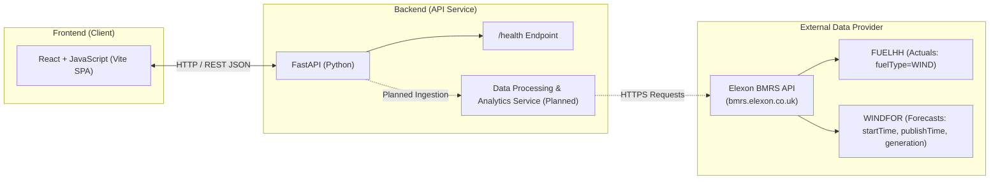
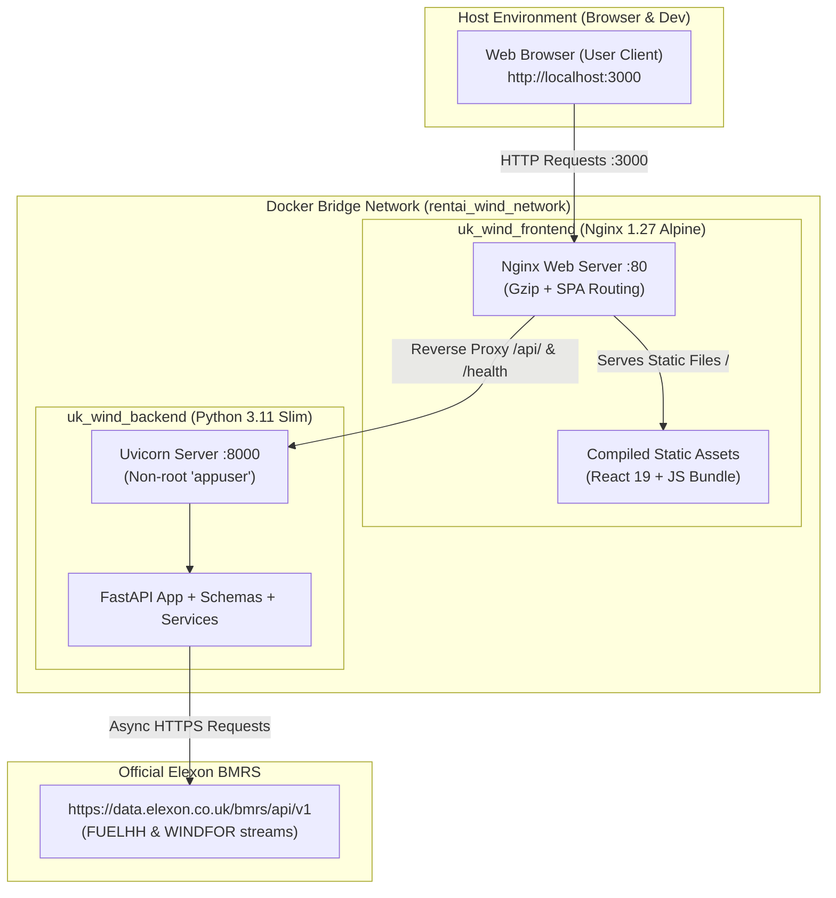

# UK Wind Forecast Analytics - Architecture Overview

## 1. System Purpose & Scope
**UK Wind Forecast Analytics** is a full-stack analytical platform designed to evaluate UK national-level wind energy generation and inform energy purchasing decisions, with a specific focus on January 2026.

The platform provides visibility into:
- Actual UK wind power generation.
- Historical wind generation forecasts across lead times.
- Forecast error / variance analysis to support energy purchasing and hedging strategies.

---

## 2. High-Level Architecture

The project follows a clean, decoupled monorepo architecture:

---

## 3. Component Breakdown

### 3.1 Frontend (`frontend/`)
- **Technology Stack**: React 19, JavaScript (ES modules), Vite.
- **Role**: Present interactive dashboards, time-series visualizations, and variance metrics for decision-makers.
- **Communication**: Consumes backend REST endpoints via standard browser `fetch` or HTTP client with CORS configuration.
- **Design Philosophy**: Minimal, modular, and responsive without overly complex state management libraries until justified.

### 3.2 Backend (`backend/`)
- **Technology Stack**: Python 3.9+, FastAPI, Uvicorn, Pydantic, HTTPX.
- **Role**:
  - Serves REST API endpoints (including service health checks).
  - Interfaces with the official Elexon BMRS API.
  - Normalizes, validates, and aligns forecast time-series (`WINDFOR`) with actual outturn (`FUELHH`).
  - Computes forecast error metrics (e.g., MAE, RMSE, bias) and purchasing insights.
- **Simplicity Guideline**: Avoids unnecessary databases, premature microservices, or complex ORM layers. Data processing is kept lean, clear, and maintainable for any junior developer.

### 3.3 External Data Source (Elexon BMRS API)
- **Official Documentation**: [https://bmrs.elexon.co.uk/api-documentation/endpoint](https://bmrs.elexon.co.uk/api-documentation/endpoint)
- **Target Datasets**:
  1. **FUELHH** (Half-Hourly Generation by Fuel Type): Filtered specifically to `fuelType = WIND` for actual outturn.
  2. **WINDFOR** (Wind Generation Forecast): Capturing `startTime`, `publishTime`, and `generation` across forecast horizons.
- **Status**: Empirically verified against official Elexon Insights Solution stream endpoints (`/datasets/FUELHH/stream` and `/datasets/WINDFOR/stream`).

---

## 4. Forecast Selection, Temporal Alignment & Accuracy Metrics (Task 4)

### 4.1 Forecast Selection Policies
To prevent lookahead bias in evaluating trading and purchasing decisions, the backend provides three configurable cutoff policies:

1. **Policy A — Day-Ahead Fixed Cutoff (`day_ahead`) [Default]**:
   - For delivery date $D$, selects the latest forecast whose `publishTime` is at or before $(D - 1)$ at a configured cutoff time (default `12:00` UTC).
   - **Provisional Project Assumption**: The 12:00 UTC noon cutoff corresponds to standard Day-Ahead auction timings (e.g. EPEX SPOT GB Day-Ahead auction closing at 11:00/12:00 UTC). It is a configurable analytical assumption for this project, not an officially mandated Elexon BMRS market rule.
2. **Policy B — Rolling Lead Time (`rolling`)**:
   - Evaluates forecasts available at a specific lead time $L$ prior to interval delivery: `publishTime <= startTime - L hours`.
   - Supports horizons such as 48h, 24h, 12h, 4h, or 1h.
3. **Policy C — Latest Available Before Delivery (`latest_before_delivery`)**:
   - Operational benchmark selecting the most recent forecast published before delivery start: `publishTime <= startTime`.
   - Labeled as an operational benchmark, distinct from day-ahead purchasing decisions.

**Tie-Breaking Rule**: When two forecast revisions share the exact same `publishTime` for the same delivery interval, deterministic tie-breaking selects the forecast record with the higher generation value.

### 4.2 Temporal Alignment (Half-Hourly Actuals to Hourly Forecasts)
- **FUELHH Actuals**: Reported half-hourly (settlement periods 1–48 per day).
- **WINDFOR Forecasts**: Published on hourly start times (00:00, 01:00, ..., 23:00 UTC).
- **Alignment Method**:
  - Hourly delivery interval starting at $T$ maps to two settlement periods: $2k-1$ (at $T$) and $2k$ (at $T + 30\text{m}$).
  - The hourly actual generation is calculated as the **arithmetic mean**:
    $$\text{Actual}_{\text{hourly}} = \frac{\text{Actual}_{\text{period } 2k-1} + \text{Actual}_{\text{period } 2k}}{2.0}$$
  - **Completeness Requirement**: Both half-hourly readings must be present. If either reading is missing, the hour is marked `INCOMPLETE_ACTUAL` and excluded from error metrics.
  - **No Double-Counting**: Megawatt (MW) values represent average power rate, not energy volume; therefore, values are never summed or doubled.

### 4.3 Forecast Error Metrics & Sign Convention
Metrics are evaluated exclusively over valid, matched intervals:

- **Signed Error**:
  $$\text{Error}_i = \text{Forecast}_i - \text{Actual}_i$$
  - $\text{Error} > 0$: **Over-forecasting** (forecast exceeded actual outturn; energy buyer would be long / over-purchased).
  - $\text{Error} < 0$: **Under-forecasting** (forecast fell short of outturn; energy buyer would be short / under-purchased).
- **MAE (Mean Absolute Error)**:
  $$\text{MAE} = \frac{1}{N} \sum_{i=1}^N |\text{Forecast}_i - \text{Actual}_i| \quad (\text{MW})$$
- **RMSE (Root Mean Squared Error)**:
  $$\text{RMSE} = \sqrt{\frac{1}{N} \sum_{i=1}^N (\text{Forecast}_i - \text{Actual}_i)^2} \quad (\text{MW})$$
- **Bias**:
  $$\text{Bias} = \frac{1}{N} \sum_{i=1}^N (\text{Forecast}_i - \text{Actual}_i) \quad (\text{MW})$$
  Positive bias indicates systematic over-forecasting.
- **MAPE (Mean Absolute Percentage Error)**:
  $$\text{MAPE} = \frac{100}{M} \sum_{i: \text{Actual}_i \neq 0} \frac{|\text{Forecast}_i - \text{Actual}_i|}{|\text{Actual}_i|} \quad (\%)$$
  Zero actuals are excluded from the denominator to avoid division by zero. If no eligible non-zero actuals exist, MAPE returns `null`.
- **Coverage**:
  $$\text{Coverage Ratio} = \frac{\text{Matched Intervals}}{\text{Expected Intervals}} \quad (24 \times \text{Days})$$
- **Absence of Data**: When $N = 0$, all accuracy metrics return `null` with explanatory `data_notes`, never fabricated as zero.

---

## 5. Containerization & Reverse-Proxy Architecture (Task 6)

The application provides a containerized setup orchestrated via `docker-compose.yml`:

### 5.1 Docker Architecture Details
1. **Backend Container (`uk_wind_backend`)**:
   - Base image: `python:3.11-slim` for minimal surface area and high security.
   - Non-root user: Executes as `appuser:appuser` (UID/GID created without shell).
   - Fast layer caching: `requirements.txt` installed prior to application copying.
   - Native Health Check: Uses standard Python `urllib.request` against `http://127.0.0.1:8000/health` (no curl dependency).
   - Dynamic port binding: Binds Uvicorn to `0.0.0.0:${PORT}` for cloud compatibility.

2. **Frontend Container (`uk_wind_frontend`)**:
   - Multi-stage build:
     - *Stage 1 (Builder)*: `node:20-alpine` compiling React 19 + Vite bundle via `npm ci` and `npm run build`.
     - *Stage 2 (Runtime)*: `nginx:alpine` serving compiled static files from `/usr/share/nginx/html`.
   - Reverse Proxy Configuration (`frontend/nginx.conf`):
     - Resolves the Docker host-resolution boundary: Browsers on host connect to `http://localhost:3000`.
     - Nginx transparently proxies `/api/` and `/health` requests directly to `http://backend:8000/`.
     - Gzip compression enabled for JS, CSS, JSON, and SVG assets.
     - Single Page Application (SPA) routing with `try_files $uri $uri/ /index.html;`.
   - Health Check: Queries `/nginx-health` internal status endpoint.

---

## 6. Deployment Strategy

### 6.1 Recommended Platform Architectures

#### Option A: Independent Decoupled Deployments (Vercel + Render / Heroku) [Recommended]
1. **Frontend (Vercel)**:
   - Framework preset: Vite.
   - Root directory: `frontend/`.
   - Build command: `npm run build`.
   - Output directory: `dist`.
   - Environment variable: `VITE_API_BASE_URL=https://<your-backend-slug>.onrender.com` (or Heroku app URL).
2. **Backend (Render / Heroku / Railway)**:
   - Root directory: `backend/` (or repository root pointing to `backend/Dockerfile`).
   - Start command: `uvicorn main:app --host 0.0.0.0 --port $PORT`.
   - Environment variables:
     - `CORS_ORIGINS=https://<your-frontend-slug>.vercel.app`
     - `PORT=8000` (automatically set by hosting platform)
   - Health check path: `/health`.

#### Option B: Unified Containerized Host (Render Web Service / Fly.io / AWS ECS)
- Deploy the Docker Compose stack or multi-service container setup directly using the verified `docker-compose.yml`.

---

## 7. Security & Environment Configuration Isolation

1. **Vite Public Build-Time Variables**:
   - Variables prefixed with `VITE_` (e.g. `VITE_API_BASE_URL`) are statically baked into the client-side JavaScript bundle during `npm run build`.
   - **Strict Rule**: No secrets, private credentials, or internal server keys may ever use the `VITE_` prefix.
2. **Backend Runtime Variables**:
   - Stored in server environment or loaded via `python-dotenv` from `.env`.
   - Private to the Python process and inaccessible to browser clients.
3. **CORS Hardening**:
   - Configurable via `CORS_ORIGINS` environment variable.
   - Restricts cross-origin requests to explicit client origins (`http://localhost:3000`, `http://localhost:5173`, and production domains).
4. **Data Provider Access**:
   - Elexon Insights Solution REST endpoints (`data.elexon.co.uk`) are public and do not mandate an API key for normal analytical queries.

